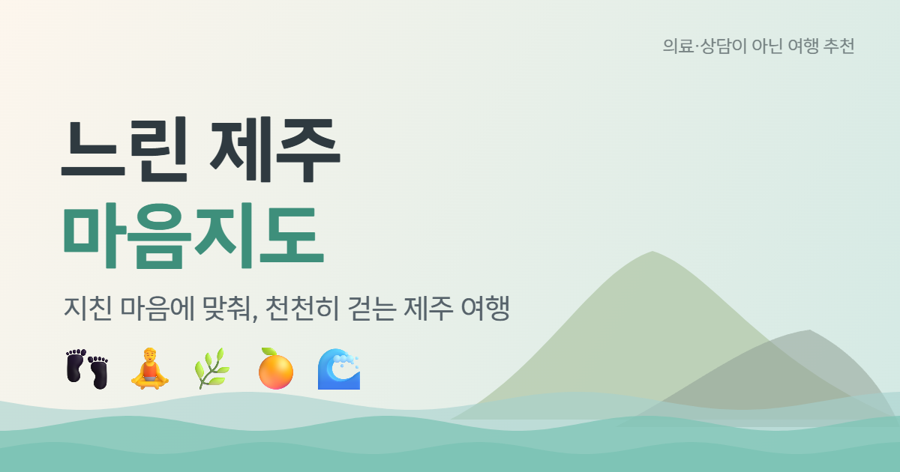

<div align="center">



# 🌊 느린 제주 마음지도

**지친 마음에 맞춰, 천천히 걷는 제주 여행**

오늘의 기분을 고르면 3D 제주섬 위에서 그 기분에 어울리는 느린 하루 동선을 짜 주는 여행 추천 웹앱

### 🔗 [projectjeju.vercel.app](https://projectjeju.vercel.app/)


휴대폰 카메라로 QR을 비추면 바로 열려요.


</div>

> ⚠️ 이 앱은 **의료·상담이 아닌 여행 추천**입니다. 마음을 진단하거나 치료한다고 말하지 않습니다.
> 힘든 마음이 계속되면 **109(자살예방상담전화)**, **1577-0199(정신건강상담전화)** 에 연락해 주세요.

---

## ✨ 어떤 앱인가요?

바쁘게 돌아다니는 여행 대신, **마음이 편해지는 느린 제주 여행**을 제안합니다.
기분을 슬라이더로 알려 주면 조용하고 가까운 곳, 앉아 쉴 곳, 걷기 좋은 곳을 골라 하루 3~4곳의 동선으로 이어 줍니다.
화면의 모든 문장은 부드러운 존댓말이고, 색은 계절(봄·여름·가을·겨울)에 따라 저절로 바뀝니다.

## 🧭 주요 기능

| | 기능 | 설명 |
|---|---|---|
| 🙂 | **오늘의 마음** | 지침 ↔ 활기 5단계 슬라이더. 이모지와 이름을 함께 보여 색에만 기대지 않아요 |
| 🗺️ | **3D 제주 지도** | 공개 고도 자료로 만든 지형 위에 관광지 990곳을 핀으로 표시. 장소 종류별 칩 필터와 이름·주소 검색 |
| 🌤️ | **날씨·시간대** | 기상청 예보, 공기질·자외선·일출·일몰, 지금 시각에 어울리는 한 줄 ("커피 마시기 좋은 시간") |
| 🚶 | **하루 동선** | 기분에 맞춘 추천 동선, 직접 담기, 자동차·걷기·버스 이동 수단별 시간과 거리, 버스 구간 세부 정보 |
| 🐚 | **몽숨이 AI 가이드** | 해녀를 닮은 3D 캐릭터와 대화하며 코스를 묻거나 "함께 여행 계획 세우기"로 코스 카드를 받아요 |
| 🍊 | **리뷰·찜** | 감귤 별점과 한마디, 해시태그, 마음에 드는 곳 찜하기 |
| 📔 | **나의 여행 기록** | 장소마다 사진 한 장과 글(300자). **떠나기 전 / 다녀온 뒤 기분**을 이모지로 남겨 마음의 변화를 돌아볼 수 있어요 |
| 🌿 | **제주 웰니스관광지** | Visit Jeju 공식 목록의 곳에 라벨 표시 (인증·효과를 뜻하지 않아요) |

## 🛡️ 안전과 개인정보를 위한 설계

웰니스·정신건강을 주제로 하는 만큼, 기능보다 **하지 않을 것**을 먼저 정했습니다.

- **진단·치료·효과 단정 금지**: "~하면 나아져요" 같은 표현을 쓰지 않습니다. `src/lib/wording.test.js`가 화면 소스에 `치유`·`치료`·`힐링`·`우울증` 등이 들어오면 테스트를 실패시킵니다. (공식 장소 이름만 예외)
- **위험 문구 두 겹 방어**: 챗과 여행 기록 입력에서 위험 문구가 감지되면 코스 대신 다정한 한두 문장과 109·1577-0199 안내를 먼저 보여 줍니다. 챗은 서버가 모델을 부르기 전에 먼저 점검하고, AI 지시문에도 같은 규칙을 넣었습니다. 여행 기록은 첫 저장에서 안내를 읽게 한 뒤 한 번 더 눌러야 저장돼요.
- **감정 점수를 저장하지 않아요**: 기분은 이모지 이름만 남기고, 좋아졌는지 평가하는 말도 하지 않습니다.
- **기록은 나만 보여요**: 여행 기록·찜·사진은 로그인한 본인만 읽고 쓰도록 Supabase RLS로 막았고, 사진 보관함도 비공개입니다. (리뷰만 공개)
- **AI는 확인한 것만 말해요**: 장소·날씨·버스 정보는 도구로 조회한 결과만 말하고, 없는 영업시간이나 가격을 지어내지 않습니다.
- **남용 방지**: 같은 IP 기준 챗 1분 15번·1시간 100번 등 호출 횟수를 제한합니다.

## 🤖 AI 에이전트가 쓰는 도구

몽숨이는 대화 중 필요하면 아래 도구를 직접 호출해 답합니다. (`server/tools.js`)

| 도구 | 하는 일 |
|---|---|
| `get_weather` | 지금 날씨·기온·체감온도·미세먼지·일출·일몰·자외선 |
| `search_spots` | 기분과 종류에 맞는 관광지 검색 |
| `get_spot_detail` | 관광지 한 곳의 소개·주소·위치 |
| `search_olle_courses` | 제주 올레코스 이름·거리·소요시간 |
| `search_bus_routes` | 버스 노선 번호·종점 |
| `find_bus_stops_near` | 관광지 근처 정류소와 걷는 거리 |
| `get_bus_arrivals` | 정류소별 버스 예상 도착 시간 |

## 🧰 기술 스택

| 구분 | 사용 |
|---|---|
| 프론트엔드 | React 19, Vite 8, React Router 7, Zustand, Bootstrap 5 |
| 3D | three.js, @react-three/fiber, @react-three/drei (지형·핀·몽숨이 캐릭터 `.glb`) |
| 2D 지도 | Leaflet (세부 지도) |
| 백엔드 | Vercel 서버리스 함수 (`api/`), 개발 중에는 Vite 플러그인이 같은 코드를 실행 |
| AI | Google Gemini (`@google/genai`). 모델 호출은 `server/llm.js` 한 곳으로만 지나가서, 공급자를 어댑터로 바꿔 끼울 수 있는 구조 (Claude 어댑터는 예정) |
| 데이터베이스·인증 | Supabase (이메일 로그인, Postgres, 비공개 Storage, RLS) |
| 폰트 | LINE Seed Sans KR |

## 🌐 사용한 공공·오픈 데이터

| 데이터 | 출처 |
|---|---|
| 제주 관광지·관광지 이미지 | 공공데이터포털 (odcloud, 한국관광공사 TourAPI) |
| 올레코스 현황 | 공공데이터포털 (odcloud) |
| 단기 예보 | 기상청 (공공데이터포털) |
| 공기질·자외선·일출·일몰 | Open-Meteo |
| 웰니스관광지 목록·관광 정보 | Visit Jeju |
| 버스 노선·정류소·도착 정보 | 제주데이터허브, 제주버스정보시스템 |
| 주변 카페·식당, 장소 위치 | Kakao 로컬 API |
| 자동차 이동 시간·거리 | OSRM |
| 섬 윤곽 | © OpenStreetMap contributors |
| 지형 고도 | AWS Terrain Tiles / SRTM |
| 일부 장소 사진 | Wikimedia Commons (화면에 작가·출처 표시) |

## 🚀 실행하기

```bash
git clone https://github.com/hyeonjukim100-sketch/project_jeju.git
cd project_jeju
npm install
cp .env.example .env.local   # 아래 표를 보고 값을 채우세요
npm run dev                  # http://localhost:5173
```

### 환경변수

`.env.example`을 복사해 `.env.local`에 채웁니다. **`VITE_`로 시작하는 값만 브라우저에 들어갑니다.** 나머지는 서버(`/api`)에서만 쓰는 비밀 키이니 절대 `VITE_`를 붙이거나 저장소에 올리지 마세요.

| 이름 | 용도 |
|---|---|
| `VITE_SUPABASE_URL`, `VITE_SUPABASE_ANON_KEY` | Supabase 연결 (공개돼도 되는 값, 데이터는 RLS가 지켜요) |
| `DATA_GO_KR_KEY` | 공공데이터포털 (관광지·기상청) |
| `KAKAO_REST_KEY` | Kakao 로컬 API |
| `VISIT_JEJU_API` | Visit Jeju |
| `JEJU_BUS_KEY` | 제주데이터허브 버스 노선 |
| `LLM_PROVIDER`, `GEMINI_API_KEY`, `GEMINI_MODEL` | AI 가이드 (현재 `gemini`만 지원, `ANTHROPIC_API_KEY`는 Claude 어댑터를 붙일 때 사용) |
| `VITE_SITE_URL` | (배포) 링크 미리보기용 배포 주소, 예: `https://내-주소.vercel.app` |

### Supabase 설정

Supabase 대시보드의 **SQL Editor**에서 `supabase/` 폴더의 파일을 **아래 순서대로** 실행합니다. (여러 번 실행해도 안전합니다)

1. `schema.sql`
2. `step5_auth.sql` — 로그인한 본인만 읽고 쓰도록 정책 변경 (수업용 익명 정책 제거)
3. `step8_reviews_trips.sql` — 리뷰, 여행 기록
4. `step9_favorites_photos.sql` — 찜, 사진 보관함
5. `step10_trip_update.sql` — 여행 기록 수정
6. `step11_trip_mood.sql` — 떠나기 전 / 다녀온 뒤 기분

Authentication의 **Site URL**과 **Redirect URLs**에는 개발 주소와 배포 주소를 모두 추가하세요.

### 배포 (Vercel)

1. GitHub 저장소를 Vercel에 가져옵니다.
2. Project Settings → Environment Variables에 위 환경변수를 입력합니다.
3. 배포 후 Supabase의 Site URL·Redirect URLs에 배포 주소를 추가합니다.

### 테스트

```bash
npm test   # node:test, 순수 로직·호출 제한·문구 점검
```

## 🗂️ 폴더 구조

```
api/          Vercel 서버리스 함수 (chat, plan, route, legs, places, weather, spots, bus-leg ...)
server/       외부 API 호출·AI 에이전트(agent.js, tools.js)·호출 제한(rateLimit.js)
src/
  components/ 기분 슬라이더, 3D 지도, 장소 상세, 챗, 여행 기록 등
  pages/      Home, My(나의 여행 기록), TripWrite(여행 기록 쓰기)
  lib/        위험 문구(crisis), 기분(moods), 계절 팔레트(season), 웰니스 목록 ...
supabase/     데이터베이스 SQL (단계별)
public/       og.png, 이모지, 몽숨이 3D 모델(models/)
blender/      몽숨이 모델을 만든 Blender 스크립트
docs/         설계·계획 문서, 인수인계 메모(NEXT.md)
```

## 📌 알려진 한계

- 버스 안내는 **직행 노선만** 찾고 환승은 다루지 않습니다.
- 버스 세부 정보는 제주버스정보시스템의 비공식 내부 API를 쓰므로 바뀔 수 있습니다.
- 관광지 좌표 일부는 원본 자료가 부정확해 직접 보정했지만(`server/tour.js`), 아직 틀린 곳이 있을 수 있습니다.
- 위험 문구 감지는 키워드 방식이라 돌려 말한 표현은 놓칠 수 있습니다. 그래서 AI 지시문에도 같은 규칙을 함께 둡니다.
- 호출 횟수 제한은 서버리스 인스턴스마다 따로 세는 간단한 방어입니다.

## 🙏 크레딧

- 이모지: [Fluent Emoji 3D](https://github.com/microsoft/fluentui-emoji) (Microsoft, MIT)
- 폰트: LINE Seed Sans KR (OFL, [LINE Seed](https://seed.line.me/)) — npm 패키지 `@kfonts/line-seed-sans-kr`
- 지도: [Leaflet](https://leafletjs.com/), © [OpenStreetMap](https://www.openstreetmap.org/copyright) contributors
- 지형 고도: AWS Terrain Tiles, SRTM
- 날씨: 기상청, [Open-Meteo](https://open-meteo.com/)
- 관광·웰니스 정보: 한국관광공사 TourAPI, [Visit Jeju](https://visitjeju.net/)
- 버스: 제주데이터허브, 제주버스정보시스템
- 장소 검색: Kakao 로컬 API
- 사진: Wikimedia Commons 및 공공데이터포털 관광지 이미지 (사진마다 출처 표시)

> 이 프로젝트는 제주 콘텐츠·문화 IP를 주제로 한 학습·시연용 작품입니다.
